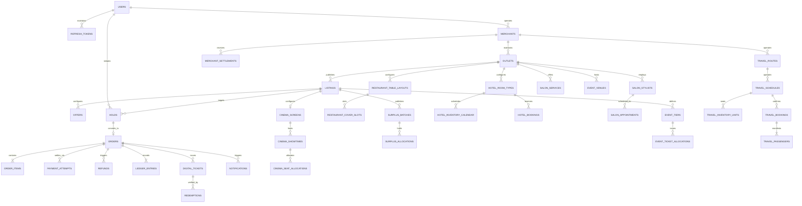

# OneHopz — Data Model & Schema Specification

**Document Version:** 1.1.0  
**Status:** Approved Technical Specification (Milestone 1.2 Finalized)  
**Database Engine:** PostgreSQL 16 with PostGIS 3.4 Extension  
**Data Integrity:** ACID-Compliant, Foreign Key Enforced, Double-Entry Immutable Ledger

---

## 1. Architectural Principles of the Data Layer

1. **Shared Core vs. Category-Specific Schema**: Core transactional, identity, financial, and organizational tables are universally shared. Inventory structures are segregated into dedicated category tables, preventing schema bloat and untyped JSON anti-patterns.
2. **PostgreSQL as Sole Authoritative Source of Truth**: All reservation states, hold expirations, and financial entries are persisted and validated in PostgreSQL. Redis keyspace expiration is never relied upon for database correctness. Holds expire authoritatively based on PostgreSQL `expires_at` column evaluations.
3. **Strict Concurrency Guards**: Double-booking is rendered impossible at the database engine level via composite unique constraints, PostgreSQL row-level locks (`SELECT ... FOR UPDATE`), and range exclusion constraints (`EXCLUDE USING gist`).
4. **Immutable Double-Entry Financial Ledger**: Money movements (orders, payments, commissions, taxes, refunds, payouts) are stored as append-only ledger entries. Database triggers strictly prevent `UPDATE` and `DELETE` on ledger records. Balances are derived from aggregations, not mutable balance columns.
5. **No Customer Stored-Value Wallets**: The schema does not include customer wallet tables, balances, or stored values. All payouts flow directly from payment gateway escrow/nodal accounts to merchant bank accounts.
6. **Demonstration & Production Partitioning**: All major transactional tables feature an indexed `is_demo BOOLEAN NOT NULL DEFAULT FALSE` column. Demo and jury scenarios run in an isolated logical partition that cannot contaminate statutory tax, financial, or merchant bank settlement records.

---

## 2. Entity-Relationship Architecture Diagram



---

## 3. Shared Core Relational Schema

### 3.1 Identity, Authentication & Refresh Tokens

```sql
-- User Roles
CREATE TYPE user_role_enum AS ENUM (
    'CUSTOMER', 
    'MERCHANT_STAFF', 
    'MERCHANT_ADMIN', 
    'PLATFORM_SUPPORT', 
    'FINANCE_ADMIN', 
    'SUPER_ADMIN'
);

-- Users
CREATE TABLE users (
    id UUID PRIMARY KEY DEFAULT gen_random_uuid(),
    email VARCHAR(255) UNIQUE NOT NULL,
    phone_number VARCHAR(20) UNIQUE NOT NULL,
    password_hash VARCHAR(255) NOT NULL,
    first_name VARCHAR(100) NOT NULL,
    last_name VARCHAR(100) NOT NULL,
    role user_role_enum NOT NULL DEFAULT 'CUSTOMER',
    is_active BOOLEAN NOT NULL DEFAULT TRUE,
    is_demo BOOLEAN NOT NULL DEFAULT FALSE,
    created_at TIMESTAMP WITH TIME ZONE NOT NULL DEFAULT CLOCK_TIMESTAMP(),
    updated_at TIMESTAMP WITH TIME ZONE NOT NULL DEFAULT CLOCK_TIMESTAMP()
);

CREATE INDEX idx_users_email_role ON users (email, role);
CREATE INDEX idx_users_phone ON users (phone_number);
CREATE INDEX idx_users_is_demo ON users (is_demo);

-- Secure HttpOnly Refresh Tokens (Rotated on each use)
CREATE TABLE refresh_tokens (
    id UUID PRIMARY KEY DEFAULT gen_random_uuid(),
    user_id UUID NOT NULL REFERENCES users(id) ON DELETE CASCADE,
    token_hash VARCHAR(64) UNIQUE NOT NULL, -- SHA-256 hash of random 64-byte token
    expires_at TIMESTAMP WITH TIME ZONE NOT NULL,
    is_revoked BOOLEAN NOT NULL DEFAULT FALSE,
    replaced_by_token_id UUID REFERENCES refresh_tokens(id),
    created_at TIMESTAMP WITH TIME ZONE NOT NULL DEFAULT CLOCK_TIMESTAMP(),
    revoked_at TIMESTAMP WITH TIME ZONE
);

CREATE INDEX idx_refresh_tokens_lookup ON refresh_tokens (token_hash) WHERE is_revoked = FALSE;
CREATE INDEX idx_refresh_tokens_user ON refresh_tokens (user_id);
```

### 3.2 Organizations & Outlets with PostGIS

```sql
-- Merchant Organizations
CREATE TABLE merchants (
    id UUID PRIMARY KEY DEFAULT gen_random_uuid(),
    business_name VARCHAR(255) NOT NULL,
    legal_entity_name VARCHAR(255) NOT NULL,
    gstin VARCHAR(15),
    pan VARCHAR(10),
    fssai_license_number VARCHAR(14), -- Required for food categories
    primary_contact_user_id UUID NOT NULL REFERENCES users(id),
    verification_status VARCHAR(50) NOT NULL DEFAULT 'PENDING_VERIFICATION', -- PENDING_VERIFICATION, VERIFIED, REJECTED, SUSPENDED
    is_active BOOLEAN NOT NULL DEFAULT TRUE,
    is_demo BOOLEAN NOT NULL DEFAULT FALSE,
    bank_account_number VARCHAR(34),
    bank_ifsc VARCHAR(11),
    created_at TIMESTAMP WITH TIME ZONE NOT NULL DEFAULT CLOCK_TIMESTAMP(),
    updated_at TIMESTAMP WITH TIME ZONE NOT NULL DEFAULT CLOCK_TIMESTAMP()
);

CREATE INDEX idx_merchants_verification ON merchants (verification_status);
CREATE INDEX idx_merchants_is_demo ON merchants (is_demo);

-- Merchant Outlets (Physical Venues with PostGIS Coordinates)
CREATE TABLE outlets (
    id UUID PRIMARY KEY DEFAULT gen_random_uuid(),
    merchant_id UUID NOT NULL REFERENCES merchants(id) ON DELETE CASCADE,
    name VARCHAR(255) NOT NULL,
    category VARCHAR(50) NOT NULL, -- CINEMA, RESTAURANT, SURPLUS_FOOD, HOTEL, SALON, EVENT, TRAVEL
    address_line_1 VARCHAR(255) NOT NULL,
    address_line_2 VARCHAR(255),
    city VARCHAR(100) NOT NULL,
    state VARCHAR(100) NOT NULL,
    postal_code VARCHAR(20) NOT NULL,
    country_code VARCHAR(2) NOT NULL DEFAULT 'IN',
    geom GEOMETRY(Point, 4326) NOT NULL, -- WGS 84 Point (Longitude, Latitude)
    is_active BOOLEAN NOT NULL DEFAULT TRUE,
    is_demo BOOLEAN NOT NULL DEFAULT FALSE,
    created_at TIMESTAMP WITH TIME ZONE NOT NULL DEFAULT CLOCK_TIMESTAMP(),
    updated_at TIMESTAMP WITH TIME ZONE NOT NULL DEFAULT CLOCK_TIMESTAMP()
);

-- PostGIS Spatial Index for <=200ms radius discovery
CREATE INDEX idx_outlets_geom ON outlets USING GIST (geom);
CREATE INDEX idx_outlets_category_city ON outlets (category, city);
CREATE INDEX idx_outlets_is_demo ON outlets (is_demo);

-- Outlet Staff Assignments
CREATE TABLE outlet_staff (
    id UUID PRIMARY KEY DEFAULT gen_random_uuid(),
    outlet_id UUID NOT NULL REFERENCES outlets(id) ON DELETE CASCADE,
    user_id UUID NOT NULL REFERENCES users(id) ON DELETE CASCADE,
    staff_role VARCHAR(50) NOT NULL DEFAULT 'STAFF', -- MANAGER, CASHIER, SCANNER_OPERATOR
    is_active BOOLEAN NOT NULL DEFAULT TRUE,
    created_at TIMESTAMP WITH TIME ZONE NOT NULL DEFAULT CLOCK_TIMESTAMP(),
    CONSTRAINT uq_outlet_staff UNIQUE (outlet_id, user_id)
);
```

### 3.3 Catalog, Listings & Dynamic Offers

#### 3.3.1 Relational Architecture & Implemented Django Schema (Milestone 1.5)

In Milestone 1.5, the Catalog and Offer domain models were formally established in `apps.catalog` and `apps.offers` with tenant-scoped validation and database constraints:

```sql
-- Catalog Items (apps.catalog.models.CatalogItem)
CREATE TABLE catalog_catalogitem (
    id UUID PRIMARY KEY DEFAULT gen_random_uuid(),
    merchant_id UUID NOT NULL REFERENCES merchants_merchant(id) ON DELETE CASCADE,
    outlet_id UUID REFERENCES merchants_outlet(id) ON DELETE SET NULL,
    category VARCHAR(50) NOT NULL, -- CINEMA, RESTAURANT, SURPLUS_FOOD, HOTEL, SALON, EVENT, TRAVEL
    title VARCHAR(255) NOT NULL,
    description TEXT NOT NULL DEFAULT '',
    base_price NUMERIC(12, 2) NOT NULL,
    currency VARCHAR(3) NOT NULL DEFAULT 'INR',
    is_active BOOLEAN NOT NULL DEFAULT TRUE,
    is_demo BOOLEAN NOT NULL DEFAULT FALSE,
    metadata JSONB NOT NULL DEFAULT '{}',
    created_at TIMESTAMP WITH TIME ZONE NOT NULL DEFAULT CLOCK_TIMESTAMP(),
    updated_at TIMESTAMP WITH TIME ZONE NOT NULL DEFAULT CLOCK_TIMESTAMP(),
    CONSTRAINT chk_catalog_item_base_price_non_negative CHECK (base_price >= 0.00)
);

CREATE INDEX idx_cat_item_merchant_active ON catalog_catalogitem (merchant_id, is_active);
CREATE INDEX idx_cat_item_cat_active ON catalog_catalogitem (category, is_active);
CREATE INDEX idx_cat_item_outlet_active ON catalog_catalogitem (outlet_id, is_active);

-- Offer Specifications (apps.offers.models.OfferSpecification)
CREATE TABLE offers_offerspecification (
    id UUID PRIMARY KEY DEFAULT gen_random_uuid(),
    merchant_id UUID NOT NULL REFERENCES merchants_merchant(id) ON DELETE CASCADE,
    outlet_id UUID REFERENCES merchants_outlet(id) ON DELETE SET NULL,
    catalog_item_id UUID REFERENCES catalog_catalogitem(id) ON DELETE CASCADE,
    category VARCHAR(50),
    title VARCHAR(255) NOT NULL,
    description TEXT NOT NULL DEFAULT '',
    offer_type VARCHAR(20) NOT NULL DEFAULT 'PERCENTAGE', -- PERCENTAGE, FIXED_AMOUNT
    discount_value NUMERIC(10, 2) NOT NULL,
    currency VARCHAR(3) NOT NULL DEFAULT 'INR',
    max_discount_amount NUMERIC(10, 2),
    floor_price NUMERIC(10, 2),
    valid_from TIMESTAMP WITH TIME ZONE NOT NULL,
    valid_to TIMESTAMP WITH TIME ZONE NOT NULL,
    is_active BOOLEAN NOT NULL DEFAULT TRUE,
    is_demo BOOLEAN NOT NULL DEFAULT FALSE,
    parameters JSONB NOT NULL DEFAULT '{}',
    created_at TIMESTAMP WITH TIME ZONE NOT NULL DEFAULT CLOCK_TIMESTAMP(),
    updated_at TIMESTAMP WITH TIME ZONE NOT NULL DEFAULT CLOCK_TIMESTAMP(),
    CONSTRAINT chk_offer_discount_val_gt_zero CHECK (discount_value > 0.00),
    CONSTRAINT chk_offer_valid_dates CHECK (valid_to > valid_from)
);

CREATE INDEX idx_offer_merch_active_dates ON offers_offerspecification (merchant_id, is_active, valid_from, valid_to);
CREATE INDEX idx_offer_item_active ON offers_offerspecification (catalog_item_id, is_active);
CREATE INDEX idx_offer_cat_active ON offers_offerspecification (category, is_active);
```

### 3.4 Authoritative Holds, Orders & Items

```sql
CREATE TYPE hold_status_enum AS ENUM (
    'ACTIVE', 
    'CONVERTED_TO_ORDER', 
    'EXPIRED', 
    'RELEASED_BY_USER'
);

-- Authoritative Ephemeral Holds
CREATE TABLE holds (
    id UUID PRIMARY KEY DEFAULT gen_random_uuid(),
    user_id UUID NOT NULL REFERENCES users(id),
    listing_id UUID NOT NULL REFERENCES listings(id),
    category VARCHAR(50) NOT NULL,
    status hold_status_enum NOT NULL DEFAULT 'ACTIVE',
    held_at TIMESTAMP WITH TIME ZONE NOT NULL DEFAULT CLOCK_TIMESTAMP(),
    expires_at TIMESTAMP WITH TIME ZONE NOT NULL, -- Authoritative PostgreSQL expiry timestamp
    lock_reference VARCHAR(255) NOT NULL, -- Category-specific composite locking key
    is_demo BOOLEAN NOT NULL DEFAULT FALSE
);

CREATE INDEX idx_holds_active_lookup ON holds (id, status, expires_at);
CREATE INDEX idx_holds_cleanup_sweep ON holds (expires_at) WHERE status = 'ACTIVE';
CREATE INDEX idx_holds_user ON holds (user_id, status);

CREATE TYPE order_status_enum AS ENUM (
    'PENDING_PAYMENT', 
    'PAID_CONFIRMED', 
    'PAYMENT_CAPTURED_ALLOCATION_FAILED', 
    'CANCELLED_REFUNDED', 
    'COMPLETED_REDEEMED', 
    'EXPIRED_NO_SHOW'
);

-- Orders
CREATE TABLE orders (
    id UUID PRIMARY KEY DEFAULT gen_random_uuid(),
    order_number VARCHAR(32) UNIQUE NOT NULL, -- Human-readable: OH-20261023-XXXX
    user_id UUID NOT NULL REFERENCES users(id),
    merchant_id UUID NOT NULL REFERENCES merchants(id),
    outlet_id UUID NOT NULL REFERENCES outlets(id),
    hold_id UUID UNIQUE REFERENCES holds(id),
    category VARCHAR(50) NOT NULL,
    status order_status_enum NOT NULL DEFAULT 'PENDING_PAYMENT',
    gross_amount NUMERIC(12, 2) NOT NULL,
    discount_amount NUMERIC(12, 2) NOT NULL,
    platform_fee NUMERIC(12, 2) NOT NULL,
    tax_amount NUMERIC(12, 2) NOT NULL,
    net_payable_amount NUMERIC(12, 2) NOT NULL,
    currency VARCHAR(3) NOT NULL DEFAULT 'INR',
    cancellation_policy_type VARCHAR(50) NOT NULL, -- STRICT_NON_REFUNDABLE, WINDOWED_REFUND, CONDITIONAL
    cancellation_deadline TIMESTAMP WITH TIME ZONE,
    is_demo BOOLEAN NOT NULL DEFAULT FALSE,
    created_at TIMESTAMP WITH TIME ZONE NOT NULL DEFAULT CLOCK_TIMESTAMP(),
    updated_at TIMESTAMP WITH TIME ZONE NOT NULL DEFAULT CLOCK_TIMESTAMP()
);

CREATE INDEX idx_orders_user_status ON orders (user_id, status);
CREATE INDEX idx_orders_merchant_created ON orders (merchant_id, created_at);
CREATE INDEX idx_orders_is_demo ON orders (is_demo);

-- Order Items (Specific Units / Seats / Dishes / Nights)
CREATE TABLE order_items (
    id UUID PRIMARY KEY DEFAULT gen_random_uuid(),
    order_id UUID NOT NULL REFERENCES orders(id) ON DELETE CASCADE,
    offer_id UUID NOT NULL REFERENCES offers_offerspecification(id),
    catalog_item_id UUID NOT NULL REFERENCES catalog_catalogitem(id),
    quantity INTEGER NOT NULL DEFAULT 1,
    unit_base_price NUMERIC(10, 2) NOT NULL,
    unit_sale_price NUMERIC(10, 2) NOT NULL,
    total_price NUMERIC(10, 2) NOT NULL,
    metadata JSONB NOT NULL DEFAULT '{}'
);

CREATE INDEX idx_order_items_order ON order_items (order_id);

-- Durable Order Reservations (Transferred from Ephemeral Hold)
CREATE TYPE order_reservation_status_enum AS ENUM (
    'PENDING_PAYMENT',
    'CONFIRMED',
    'EXPIRED',
    'CANCELLED'
);

CREATE TABLE order_reservations (
    id UUID PRIMARY KEY DEFAULT gen_random_uuid(),
    order_id UUID UNIQUE NOT NULL REFERENCES orders(id) ON DELETE CASCADE,
    hold_id UUID UNIQUE NOT NULL REFERENCES holds(id),
    status order_reservation_status_enum NOT NULL DEFAULT 'PENDING_PAYMENT',
    category VARCHAR(32) NOT NULL,
    lock_reference VARCHAR(255) NOT NULL,
    allocated_quantity INTEGER NOT NULL DEFAULT 1,
    reservation_payload JSONB NOT NULL DEFAULT '{}',
    payment_deadline TIMESTAMP WITH TIME ZONE NOT NULL,
    created_at TIMESTAMP WITH TIME ZONE NOT NULL DEFAULT CLOCK_TIMESTAMP(),
    updated_at TIMESTAMP WITH TIME ZONE NOT NULL DEFAULT CLOCK_TIMESTAMP()
);

CREATE INDEX idx_order_res_sweep ON order_reservations (payment_deadline) WHERE status = 'PENDING_PAYMENT';
CREATE INDEX idx_order_res_lookup ON order_reservations (order_id, status);

-- Checkout Idempotency Tracking
CREATE TABLE checkout_idempotency (
    id UUID PRIMARY KEY DEFAULT gen_random_uuid(),
    customer_id UUID NOT NULL REFERENCES users(id) ON DELETE CASCADE,
    idempotency_key VARCHAR(128) NOT NULL,
    request_hash VARCHAR(64) NOT NULL,
    order_id UUID NOT NULL REFERENCES orders(id) ON DELETE CASCADE,
    created_at TIMESTAMP WITH TIME ZONE NOT NULL DEFAULT CLOCK_TIMESTAMP(),
    CONSTRAINT uq_checkout_customer_key UNIQUE (customer_id, idempotency_key)
);
```

### 3.5 Payments, Double-Entry Ledger, Refunds & Settlements

```sql
CREATE TYPE payment_status_enum AS ENUM (
    'INITIATED', 
    'CAPTURED', 
    'FAILED', 
    'BOUNCED', 
    'REFUNDED'
);

-- Payment Attempts & Webhook Deduplication
CREATE TABLE payment_attempts (
    id UUID PRIMARY KEY DEFAULT gen_random_uuid(),
    order_id UUID NOT NULL REFERENCES orders(id),
    gateway_name VARCHAR(50) NOT NULL, -- CASHFREE, RAZORPAY, MOCK_GATEWAY
    gateway_order_id VARCHAR(100) NOT NULL,
    gateway_payment_id VARCHAR(100),
    gateway_signature VARCHAR(255),
    amount NUMERIC(12, 2) NOT NULL,
    currency VARCHAR(3) NOT NULL DEFAULT 'INR',
    status payment_status_enum NOT NULL DEFAULT 'INITIATED',
    idempotency_key VARCHAR(100) UNIQUE NOT NULL,
    gateway_event_id VARCHAR(100) UNIQUE, -- Deduplication key for webhooks
    raw_webhook_payload JSONB,
    is_demo BOOLEAN NOT NULL DEFAULT FALSE,
    created_at TIMESTAMP WITH TIME ZONE NOT NULL DEFAULT CLOCK_TIMESTAMP(),
    updated_at TIMESTAMP WITH TIME ZONE NOT NULL DEFAULT CLOCK_TIMESTAMP()
);

CREATE INDEX idx_payment_attempts_gateway_order ON payment_attempts (gateway_order_id);
CREATE INDEX idx_payment_attempts_order ON payment_attempts (order_id);

-- Refunds
CREATE TABLE refunds (
    id UUID PRIMARY KEY DEFAULT gen_random_uuid(),
    order_id UUID NOT NULL REFERENCES orders(id),
    payment_attempt_id UUID NOT NULL REFERENCES payment_attempts(id),
    gateway_refund_id VARCHAR(100),
    amount NUMERIC(12, 2) NOT NULL,
    currency VARCHAR(3) NOT NULL DEFAULT 'INR',
    reason VARCHAR(255) NOT NULL,
    status VARCHAR(50) NOT NULL DEFAULT 'PENDING', -- PENDING, SETTLED, FAILED, FAILED_NEEDS_ADMIN_REVIEW
    is_demo BOOLEAN NOT NULL DEFAULT FALSE,
    created_at TIMESTAMP WITH TIME ZONE NOT NULL DEFAULT CLOCK_TIMESTAMP(),
    settled_at TIMESTAMP WITH TIME ZONE
);

CREATE INDEX idx_refunds_order ON refunds (order_id);

-- Immutable Append-Only Ledger (Double-Entry Financial Accounting)
CREATE TABLE ledger_entries (
    id UUID PRIMARY KEY DEFAULT gen_random_uuid(),
    order_id UUID NOT NULL REFERENCES orders(id),
    account_type VARCHAR(50) NOT NULL, -- ESCROW_RECEIVABLE, MERCHANT_PAYABLE, PLATFORM_REVENUE, GST_PAYABLE, TCS_WITHHOLDING, TDS_WITHHOLDING, CUSTOMER_REFUNDABLE
    direction VARCHAR(2) NOT NULL CHECK (direction IN ('CR', 'DR')), -- Credit / Debit
    amount NUMERIC(12, 2) NOT NULL CHECK (amount > 0),
    currency VARCHAR(3) NOT NULL DEFAULT 'INR',
    description VARCHAR(255) NOT NULL,
    is_demo BOOLEAN NOT NULL DEFAULT FALSE,
    created_at TIMESTAMP WITH TIME ZONE NOT NULL DEFAULT CLOCK_TIMESTAMP()
);

CREATE INDEX idx_ledger_order_account ON ledger_entries (order_id, account_type);
CREATE INDEX idx_ledger_is_demo ON ledger_entries (is_demo);

-- Strict Immutability Rule on Ledger Entries (Prevents UPDATE or DELETE)
CREATE OR REPLACE FUNCTION enforce_ledger_immutability()
RETURNS TRIGGER AS $$
BEGIN
    RAISE EXCEPTION 'ledger_entries is strictly append-only. Modification or deletion is forbidden.';
END;
$$ LANGUAGE plpgsql;

CREATE TRIGGER trg_ledger_immutability
BEFORE UPDATE OR DELETE ON ledger_entries
FOR EACH ROW EXECUTE FUNCTION enforce_ledger_immutability();

-- Merchant Settlement Batches (Disbursements from Escrow to Merchant Bank Accounts)
CREATE TABLE merchant_settlements (
    id UUID PRIMARY KEY DEFAULT gen_random_uuid(),
    merchant_id UUID NOT NULL REFERENCES merchants(id),
    batch_reference VARCHAR(64) UNIQUE NOT NULL, -- SETTLE-20261023-XXXX
    gross_sales_amount NUMERIC(12, 2) NOT NULL,
    commission_deducted NUMERIC(12, 2) NOT NULL,
    tcs_deducted NUMERIC(12, 2) NOT NULL,
    tds_deducted NUMERIC(12, 2) NOT NULL,
    net_disbursed_amount NUMERIC(12, 2) NOT NULL,
    currency VARCHAR(3) NOT NULL DEFAULT 'INR',
    destination_bank_account VARCHAR(34) NOT NULL,
    destination_bank_ifsc VARCHAR(11) NOT NULL,
    bank_utr VARCHAR(64), -- Bank Unique Transaction Reference
    status VARCHAR(50) NOT NULL DEFAULT 'INITIATED', -- INITIATED, PROCESSING, SETTLED, FAILED
    is_demo BOOLEAN NOT NULL DEFAULT FALSE,
    settlement_period_start TIMESTAMP WITH TIME ZONE NOT NULL,
    settlement_period_end TIMESTAMP WITH TIME ZONE NOT NULL,
    disbursed_at TIMESTAMP WITH TIME ZONE,
    created_at TIMESTAMP WITH TIME ZONE NOT NULL DEFAULT CLOCK_TIMESTAMP()
);

CREATE INDEX idx_settlements_merchant ON merchant_settlements (merchant_id, status);
```

### 3.6 Passes, Redemptions, Notifications & Audit Events

```sql
-- Digital Tickets & Dynamic Passes
CREATE TABLE digital_tickets (
    id UUID PRIMARY KEY DEFAULT gen_random_uuid(),
    order_id UUID NOT NULL REFERENCES orders(id) ON DELETE CASCADE,
    ticket_code VARCHAR(32) UNIQUE NOT NULL, -- TKT-XXXX-XXXX
    qr_cryptographic_seed VARCHAR(128) NOT NULL, -- Seed for dynamic rotating TOTP QR
    backup_otp VARCHAR(6) NOT NULL, -- 6-Digit fallback code
    is_redeemed BOOLEAN NOT NULL DEFAULT FALSE,
    redeemed_at TIMESTAMP WITH TIME ZONE,
    is_demo BOOLEAN NOT NULL DEFAULT FALSE,
    valid_from TIMESTAMP WITH TIME ZONE NOT NULL,
    valid_until TIMESTAMP WITH TIME ZONE NOT NULL,
    created_at TIMESTAMP WITH TIME ZONE NOT NULL DEFAULT CLOCK_TIMESTAMP()
);

CREATE INDEX idx_tickets_code ON digital_tickets (ticket_code);
CREATE INDEX idx_tickets_order ON digital_tickets (order_id);

-- Atomic Gate Redemption Log
CREATE TABLE redemptions (
    id UUID PRIMARY KEY DEFAULT gen_random_uuid(),
    ticket_id UUID NOT NULL REFERENCES digital_tickets(id),
    staff_user_id UUID NOT NULL REFERENCES users(id),
    outlet_id UUID NOT NULL REFERENCES outlets(id),
    verification_method VARCHAR(20) NOT NULL CHECK (verification_method IN ('QR_SCAN', 'MANUAL_OTP')),
    status VARCHAR(30) NOT NULL CHECK (status IN ('SUCCESS', 'REJECTED_ALREADY_REDEEMED', 'REJECTED_EXPIRED', 'REJECTED_INVALID_OUTLET')),
    scanned_at TIMESTAMP WITH TIME ZONE NOT NULL DEFAULT CLOCK_TIMESTAMP(),
    ip_address INET,
    is_demo BOOLEAN NOT NULL DEFAULT FALSE
);

CREATE INDEX idx_redemptions_ticket ON redemptions (ticket_id);
CREATE INDEX idx_redemptions_outlet ON redemptions (outlet_id, scanned_at);

-- Transactional Notifications (Outbox Pattern)
CREATE TABLE notifications (
    id UUID PRIMARY KEY DEFAULT gen_random_uuid(),
    user_id UUID NOT NULL REFERENCES users(id),
    order_id UUID REFERENCES orders(id),
    channel VARCHAR(20) NOT NULL CHECK (channel IN ('SMS', 'EMAIL', 'WHATSAPP', 'PUSH')),
    recipient VARCHAR(255) NOT NULL, -- Phone or email address
    template_name VARCHAR(100) NOT NULL,
    payload JSONB NOT NULL DEFAULT '{}',
    status VARCHAR(20) NOT NULL DEFAULT 'QUEUED', -- QUEUED, SENT, FAILED
    retry_count INTEGER NOT NULL DEFAULT 0,
    sent_at TIMESTAMP WITH TIME ZONE,
    failed_reason TEXT,
    is_demo BOOLEAN NOT NULL DEFAULT FALSE,
    created_at TIMESTAMP WITH TIME ZONE NOT NULL DEFAULT CLOCK_TIMESTAMP()
);

CREATE INDEX idx_notifications_status ON notifications (status) WHERE status = 'QUEUED';

-- Comprehensive Audit Trail
CREATE TABLE audit_events (
    id UUID PRIMARY KEY DEFAULT gen_random_uuid(),
    actor_id UUID REFERENCES users(id),
    actor_role VARCHAR(50),
    event_type VARCHAR(100) NOT NULL, -- ORDER_PLACED, HOLD_EXPIRED, REFUND_TRIGGERED, GATE_REDEEMED, etc.
    target_entity VARCHAR(50) NOT NULL,
    target_id UUID NOT NULL,
    payload_before JSONB,
    payload_after JSONB,
    ip_address INET,
    is_demo BOOLEAN NOT NULL DEFAULT FALSE,
    created_at TIMESTAMP WITH TIME ZONE NOT NULL DEFAULT CLOCK_TIMESTAMP()
);

CREATE INDEX idx_audit_target ON audit_events (target_entity, target_id);
CREATE INDEX idx_audit_created ON audit_events (created_at);
```

---

## 4. Category-Specific Relational Schemas

### 4.1 Cinema Module Tables
```sql
CREATE TABLE cinema_screens (
    id UUID PRIMARY KEY DEFAULT gen_random_uuid(),
    outlet_id UUID NOT NULL REFERENCES outlets(id) ON DELETE CASCADE,
    name VARCHAR(100) NOT NULL, -- "Screen 1 - Dolby Atmos"
    total_capacity INTEGER NOT NULL
);

CREATE TABLE cinema_showtimes (
    id UUID PRIMARY KEY DEFAULT gen_random_uuid(),
    screen_id UUID NOT NULL REFERENCES cinema_screens(id) ON DELETE CASCADE,
    movie_title VARCHAR(255) NOT NULL,
    movie_duration_minutes INTEGER NOT NULL,
    start_time TIMESTAMP WITH TIME ZONE NOT NULL,
    end_time TIMESTAMP WITH TIME ZONE NOT NULL,
    listing_id UUID NOT NULL REFERENCES listings(id)
);

CREATE INDEX idx_cinema_showtimes_listing ON cinema_showtimes (listing_id);

CREATE TABLE cinema_seat_allocations (
    id UUID PRIMARY KEY DEFAULT gen_random_uuid(),
    showtime_id UUID NOT NULL REFERENCES cinema_showtimes(id) ON DELETE CASCADE,
    row_code VARCHAR(5) NOT NULL, -- "A", "B", "C"
    seat_number INTEGER NOT NULL, -- 1, 2, 3
    tier_name VARCHAR(50) NOT NULL, -- "EXECUTIVE", "RECLINER"
    status VARCHAR(20) NOT NULL DEFAULT 'AVAILABLE', -- AVAILABLE, HELD, RESERVED, MAINTENANCE_BLOCKED
    current_hold_id UUID REFERENCES holds(id),
    order_id UUID REFERENCES orders(id),
    CONSTRAINT uq_cinema_seat UNIQUE (showtime_id, row_code, seat_number)
);

CREATE INDEX idx_cinema_seat_lookup ON cinema_seat_allocations (showtime_id, status);
CREATE INDEX idx_cinema_seat_hold ON cinema_seat_allocations (current_hold_id);
```

### 4.2 Restaurant Module Tables
```sql
CREATE TABLE restaurant_table_layouts (
    id UUID PRIMARY KEY DEFAULT gen_random_uuid(),
    outlet_id UUID NOT NULL REFERENCES outlets(id) ON DELETE CASCADE,
    table_number VARCHAR(20) NOT NULL,
    min_covers INTEGER NOT NULL DEFAULT 1,
    max_covers INTEGER NOT NULL DEFAULT 4,
    dining_area VARCHAR(50) NOT NULL DEFAULT 'MAIN_HALL',
    is_active BOOLEAN NOT NULL DEFAULT TRUE,
    CONSTRAINT uq_restaurant_table UNIQUE (outlet_id, table_number)
);

CREATE TABLE restaurant_cover_slots (
    id UUID PRIMARY KEY DEFAULT gen_random_uuid(),
    outlet_id UUID NOT NULL REFERENCES outlets(id) ON DELETE CASCADE,
    table_id UUID NOT NULL REFERENCES restaurant_table_layouts(id) ON DELETE CASCADE,
    slot_start_time TIMESTAMP WITH TIME ZONE NOT NULL,
    slot_end_time TIMESTAMP WITH TIME ZONE NOT NULL,
    status VARCHAR(20) NOT NULL DEFAULT 'AVAILABLE', -- AVAILABLE, HELD, RESERVED, NO_SHOW
    current_hold_id UUID REFERENCES holds(id),
    order_id UUID REFERENCES orders(id),
    CONSTRAINT uq_restaurant_slot UNIQUE (table_id, slot_start_time)
);

CREATE INDEX idx_restaurant_slots_search ON restaurant_cover_slots (outlet_id, slot_start_time, status);
```

### 4.3 Surplus Food Module Tables
```sql
CREATE TABLE surplus_batches (
    id UUID PRIMARY KEY DEFAULT gen_random_uuid(),
    listing_id UUID NOT NULL REFERENCES listings(id) ON DELETE CASCADE,
    batch_title VARCHAR(255) NOT NULL, -- "Surplus Evening Pastry Box"
    pickup_window_start TIMESTAMP WITH TIME ZONE NOT NULL,
    pickup_window_end TIMESTAMP WITH TIME ZONE NOT NULL,
    packaged_at TIMESTAMP WITH TIME ZONE,
    total_quantity INTEGER NOT NULL CHECK (total_quantity > 0),
    held_quantity INTEGER NOT NULL DEFAULT 0 CHECK (held_quantity >= 0),
    sold_quantity INTEGER NOT NULL DEFAULT 0 CHECK (sold_quantity >= 0),
    dietary_type VARCHAR(50) NOT NULL, -- VEG, NON_VEG, VEGAN
    allergens TEXT[] NOT NULL DEFAULT '{}',
    CONSTRAINT chk_surplus_capacity CHECK (held_quantity + sold_quantity <= total_quantity)
);

CREATE INDEX idx_surplus_pickup_window ON surplus_batches (pickup_window_start, pickup_window_end);
CREATE INDEX idx_surplus_listing ON surplus_batches (listing_id);

-- Explicit Allocation Record for Tracking Units per Hold/Order
CREATE TABLE surplus_allocations (
    id UUID PRIMARY KEY DEFAULT gen_random_uuid(),
    batch_id UUID NOT NULL REFERENCES surplus_batches(id) ON DELETE CASCADE,
    hold_id UUID REFERENCES holds(id),
    order_id UUID REFERENCES orders(id),
    quantity INTEGER NOT NULL CHECK (quantity > 0),
    status VARCHAR(20) NOT NULL DEFAULT 'HELD', -- HELD, CONFIRMED, CANCELLED, EXPIRED
    created_at TIMESTAMP WITH TIME ZONE NOT NULL DEFAULT CLOCK_TIMESTAMP()
);

CREATE INDEX idx_surplus_alloc_hold ON surplus_allocations (hold_id);
CREATE INDEX idx_surplus_alloc_order ON surplus_allocations (order_id);
```

### 4.4 Hotel Module Tables
```sql
CREATE TABLE hotel_room_types (
    id UUID PRIMARY KEY DEFAULT gen_random_uuid(),
    outlet_id UUID NOT NULL REFERENCES outlets(id) ON DELETE CASCADE,
    name VARCHAR(100) NOT NULL, -- "Deluxe Sea View King"
    max_occupancy_adults INTEGER NOT NULL DEFAULT 2,
    total_rooms_in_inventory INTEGER NOT NULL CHECK (total_rooms_in_inventory > 0)
);

CREATE TABLE hotel_inventory_calendar (
    id UUID PRIMARY KEY DEFAULT gen_random_uuid(),
    room_type_id UUID NOT NULL REFERENCES hotel_room_types(id) ON DELETE CASCADE,
    stay_date DATE NOT NULL,
    total_available INTEGER NOT NULL CHECK (total_available > 0),
    held_count INTEGER NOT NULL DEFAULT 0 CHECK (held_count >= 0),
    booked_count INTEGER NOT NULL DEFAULT 0 CHECK (booked_count >= 0),
    nightly_base_rate NUMERIC(12, 2) NOT NULL,
    CONSTRAINT uq_hotel_room_date UNIQUE (room_type_id, stay_date),
    CONSTRAINT chk_hotel_capacity CHECK (held_count + booked_count <= total_available)
);

CREATE INDEX idx_hotel_calendar_lookup ON hotel_inventory_calendar (room_type_id, stay_date);

-- Concrete Hotel Reservation Record
CREATE TABLE hotel_bookings (
    id UUID PRIMARY KEY DEFAULT gen_random_uuid(),
    room_type_id UUID NOT NULL REFERENCES hotel_room_types(id) ON DELETE CASCADE,
    hold_id UUID REFERENCES holds(id),
    order_id UUID REFERENCES orders(id),
    check_in_date DATE NOT NULL,
    check_out_date DATE NOT NULL,
    guest_name VARCHAR(255) NOT NULL,
    guest_phone VARCHAR(20) NOT NULL,
    total_nights INTEGER NOT NULL CHECK (total_nights > 0),
    status VARCHAR(20) NOT NULL DEFAULT 'HELD', -- HELD, CONFIRMED, CHECKED_IN, CHECKED_OUT, CANCELLED
    created_at TIMESTAMP WITH TIME ZONE NOT NULL DEFAULT CLOCK_TIMESTAMP()
);

CREATE INDEX idx_hotel_bookings_order ON hotel_bookings (order_id);
CREATE INDEX idx_hotel_bookings_dates ON hotel_bookings (check_in_date, check_out_date);
```

### 4.5 Salon Module Tables
```sql
CREATE TABLE salon_services (
    id UUID PRIMARY KEY DEFAULT gen_random_uuid(),
    outlet_id UUID NOT NULL REFERENCES outlets(id) ON DELETE CASCADE,
    name VARCHAR(100) NOT NULL,
    duration_minutes INTEGER NOT NULL,
    buffer_cleanup_minutes INTEGER NOT NULL DEFAULT 10,
    standard_price NUMERIC(12, 2) NOT NULL
);

CREATE TABLE salon_stylists (
    id UUID PRIMARY KEY DEFAULT gen_random_uuid(),
    outlet_id UUID NOT NULL REFERENCES outlets(id) ON DELETE CASCADE,
    name VARCHAR(100) NOT NULL,
    tier VARCHAR(50) NOT NULL DEFAULT 'SENIOR_STYLIST',
    is_active BOOLEAN NOT NULL DEFAULT TRUE
);

CREATE TABLE salon_appointments (
    id UUID PRIMARY KEY DEFAULT gen_random_uuid(),
    stylist_id UUID NOT NULL REFERENCES salon_stylists(id),
    service_id UUID NOT NULL REFERENCES salon_services(id),
    start_time TIMESTAMP WITH TIME ZONE NOT NULL,
    end_time TIMESTAMP WITH TIME ZONE NOT NULL,
    status VARCHAR(20) NOT NULL DEFAULT 'HELD', -- HELD, CONFIRMED, COMPLETED, CANCELLED, NO_SHOW
    current_hold_id UUID REFERENCES holds(id),
    order_id UUID REFERENCES orders(id),
    created_at TIMESTAMP WITH TIME ZONE NOT NULL DEFAULT CLOCK_TIMESTAMP()
);

CREATE INDEX idx_salon_appointments_stylist ON salon_appointments (stylist_id, start_time, end_time);
CREATE INDEX idx_salon_appointments_order ON salon_appointments (order_id);
```

### 4.6 Event Module Tables
```sql
CREATE TABLE event_venues (
    id UUID PRIMARY KEY DEFAULT gen_random_uuid(),
    outlet_id UUID NOT NULL REFERENCES outlets(id) ON DELETE CASCADE,
    venue_name VARCHAR(255) NOT NULL,
    total_max_capacity INTEGER NOT NULL CHECK (total_max_capacity > 0)
);

CREATE TABLE event_tiers (
    id UUID PRIMARY KEY DEFAULT gen_random_uuid(),
    listing_id UUID NOT NULL REFERENCES listings(id) ON DELETE CASCADE,
    tier_name VARCHAR(100) NOT NULL, -- "EARLY_BIRD_VIP", "GENERAL_ADMISSION"
    total_tickets INTEGER NOT NULL CHECK (total_tickets > 0),
    held_tickets INTEGER NOT NULL DEFAULT 0 CHECK (held_tickets >= 0),
    sold_tickets INTEGER NOT NULL DEFAULT 0 CHECK (sold_tickets >= 0),
    price NUMERIC(12, 2) NOT NULL,
    CONSTRAINT chk_event_tier_capacity CHECK (held_tickets + sold_tickets <= total_tickets)
);

CREATE INDEX idx_event_tiers_listing ON event_tiers (listing_id);

-- Explicit Ticket Allocation per Order/Hold
CREATE TABLE event_ticket_allocations (
    id UUID PRIMARY KEY DEFAULT gen_random_uuid(),
    tier_id UUID NOT NULL REFERENCES event_tiers(id) ON DELETE CASCADE,
    hold_id UUID REFERENCES holds(id),
    order_id UUID REFERENCES orders(id),
    barcode VARCHAR(64) UNIQUE,
    status VARCHAR(20) NOT NULL DEFAULT 'HELD', -- HELD, CONFIRMED, REDEEMED, CANCELLED
    created_at TIMESTAMP WITH TIME ZONE NOT NULL DEFAULT CLOCK_TIMESTAMP()
);

CREATE INDEX idx_event_alloc_order ON event_ticket_allocations (order_id);
```

### 4.7 Travel Module Tables
```sql
CREATE TABLE travel_routes (
    id UUID PRIMARY KEY DEFAULT gen_random_uuid(),
    carrier_merchant_id UUID NOT NULL REFERENCES merchants(id) ON DELETE CASCADE,
    transit_mode VARCHAR(20) NOT NULL CHECK (transit_mode IN ('BUS', 'FLIGHT', 'TRAIN')),
    origin_code VARCHAR(10) NOT NULL, -- "BLR", "BOM"
    destination_code VARCHAR(10) NOT NULL,
    origin_name VARCHAR(255) NOT NULL,
    destination_name VARCHAR(255) NOT NULL
);

CREATE TABLE travel_schedules (
    id UUID PRIMARY KEY DEFAULT gen_random_uuid(),
    route_id UUID NOT NULL REFERENCES travel_routes(id) ON DELETE CASCADE,
    service_number VARCHAR(50) NOT NULL, -- "AI-504" or "KRL-9920"
    departure_time TIMESTAMP WITH TIME ZONE NOT NULL,
    arrival_time TIMESTAMP WITH TIME ZONE NOT NULL,
    total_seats INTEGER NOT NULL CHECK (total_seats > 0)
);

CREATE TABLE travel_inventory_units (
    id UUID PRIMARY KEY DEFAULT gen_random_uuid(),
    schedule_id UUID NOT NULL REFERENCES travel_schedules(id) ON DELETE CASCADE,
    seat_identifier VARCHAR(10) NOT NULL, -- "12A", "Lower-Berth-4"
    cabin_tier VARCHAR(50) NOT NULL DEFAULT 'ECONOMY',
    status VARCHAR(20) NOT NULL DEFAULT 'AVAILABLE', -- AVAILABLE, HELD, RESERVED, BLOCKED
    current_hold_id UUID REFERENCES holds(id),
    order_id UUID REFERENCES orders(id),
    CONSTRAINT uq_travel_seat UNIQUE (schedule_id, seat_identifier)
);

CREATE INDEX idx_travel_units_schedule ON travel_inventory_units (schedule_id, status);

-- Concrete Travel Booking Record
CREATE TABLE travel_bookings (
    id UUID PRIMARY KEY DEFAULT gen_random_uuid(),
    schedule_id UUID NOT NULL REFERENCES travel_schedules(id) ON DELETE CASCADE,
    hold_id UUID REFERENCES holds(id),
    order_id UUID REFERENCES orders(id),
    pnr_code VARCHAR(20),
    provider_reference VARCHAR(100),
    supplier_status VARCHAR(50) NOT NULL DEFAULT 'PROVISIONAL', -- PROVISIONAL, CONFIRMED, SUPPLIER_REJECTED, SUPPLIER_TIMEOUT, CANCELLED
    created_at TIMESTAMP WITH TIME ZONE NOT NULL DEFAULT CLOCK_TIMESTAMP()
);

CREATE INDEX idx_travel_bookings_order ON travel_bookings (order_id);
CREATE INDEX idx_travel_bookings_pnr ON travel_bookings (pnr_code);

-- Passenger Manifest Records
CREATE TABLE travel_passengers (
    id UUID PRIMARY KEY DEFAULT gen_random_uuid(),
    booking_id UUID NOT NULL REFERENCES travel_bookings(id) ON DELETE CASCADE,
    full_name VARCHAR(255) NOT NULL,
    age INTEGER NOT NULL CHECK (age > 0 AND age < 130),
    gender VARCHAR(10) NOT NULL CHECK (gender IN ('MALE', 'FEMALE', 'OTHER')),
    seat_identifier VARCHAR(10) NOT NULL
);

CREATE INDEX idx_travel_passengers_booking ON travel_passengers (booking_id);
```

---

## 5. Concurrency & Integrity Proofs

### 5.1 Prevention of Double-Booking
1. **Discrete Units (Cinema Seats, Tables, Travel Seats)**: Enforced via SQL unique composite constraints `(parent_id, unit_identifier)`. If two concurrent transactions attempt to reserve the same unit, PostgreSQL transaction serialization forces the second session to wait on the row lock and fail upon reading `HELD`/`RESERVED`.
2. **Quota Pools (Surplus Food, Event Tiers, Hotel Rooms)**: Enforced via PostgreSQL table check constraints `CHECK (held + sold <= total)`. When two concurrent transactions update capacity:
   ```sql
   UPDATE event_tiers 
   SET held_tickets = held_tickets + 2 
   WHERE id = :tier_id;
   ```
   PostgreSQL validates the check constraint at transaction commit time. If total capacity is exceeded, the transaction rolls back with a check violation.
3. **Pessimistic Row-Locking**: In application code, all hold acquisitions execute `SELECT ... FOR UPDATE` in deterministic order, eliminating race conditions and deadlocks.
