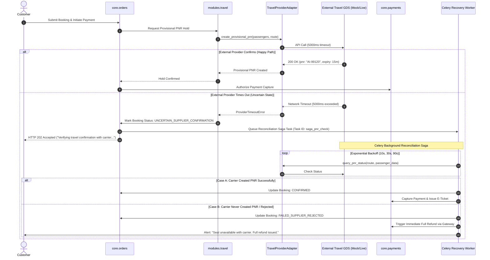

# OneHopz — System Architecture Specification

**Document Version:** 1.1.0  
**Status:** Approved Architecture Blueprint (Milestone 1.2 Finalized)  
**System Architecture:** Modular Monolith with Polymorphic Category Adapters  
**Technology Stack:** Next.js (TypeScript) + Django REST Framework (Python) + PostgreSQL / PostGIS + Celery / Redis

---

## 1. Architectural Philosophy & Principles

The OneHopz architecture is designed around seven non-negotiable architectural tenets:

1. **One Unified Platform, Not Seven Silos**: A single shared backend, single merchant portal, single customer portal, and single administrative engine power all seven verticals (Cinema, Restaurant, Surplus Food, Hotel, Salon, Events, Travel).
2. **Modular Monolith First**: High developer velocity, transactional integrity, and zero network-boundary overhead within the backend. Strict logical module boundaries enforce clean domain separation without microservice operational complexity.
3. **PostgreSQL as the Sole Source of Truth**: All reservation states, financial records, inventory allocations, hold expirations, and idempotency states are authoritatively persisted in PostgreSQL. Redis is utilized strictly for ephemeral caching, rate limiting, and Celery task brokering; **Redis notifications, keyspace events, or TTL expirations are never required for business correctness**.
4. **Capability-Driven Polymorphic Inventory**: The platform defines shared contracts (`InventoryCapability`, `SeatMapCapability`, `TimeSlotCapability`, `BatchPerishableCapability`, `DateRangeCapability`) implemented by category-specific adapters. Schema models reflect the reality of the physical vertical (e.g., cinema seats vs. perishable food bags vs. multi-night hotel rooms) rather than an artificial, lowest-common-denominator abstraction.
5. **Fail-Safe Financial & Booking Sagas**: Network calls fail, customers close browser tabs, and webhooks arrive late or out-of-order. The architecture guarantees deterministic recovery paths for orphaned payments, timed-out holds, double webhook deliveries, and external travel provider timeouts.
6. **Defensive Integration Boundaries**: All external services (payment gateways, telecom/email, GDS aggregators) sit behind abstract provider adapters with circuit breakers, exponential backoff retries, and mock demonstration implementations. Demo and live modes are strictly isolated.
7. **Strict Separation of Demonstration and Production**: Demo data, mock provider responses, and synthetic jury test scenarios are segregated via explicit flags (`is_demo=True`) to prevent contamination of audit-grade financial, tax, and merchant bank settlement ledgers.
8. **No Unlicensed Stored-Value Wallets**: The platform never stores customer funds in an internal balance or stored-value wallet. All money movements flow through licensed payment aggregator escrow/nodal accounts directly to merchant bank accounts.

---

## 2. High-Level Architecture Diagram

```mermaid
flowchart TD
    subgraph Clients["Presentation Layer (Next.js / TypeScript)"]
        CustomerWeb["Customer Web App\n(Next.js App Router)"]
        MerchantWeb["Merchant Portal\n(Next.js App Router)"]
        AdminWeb["Admin Operations\n(Next.js App Router)"]
    end

    subgraph API_Gateway["API Ingress & Edge Routing"]
        Nginx["Reverse Proxy / TLS Termination\n(Nginx / Traefik)"]
    end

    subgraph Monolith["OneHopz Modular Monolith (Django REST Framework / Python)"]
        subgraph CoreKernel["Shared Core Kernel"]
            IdentityDomain["core.identity\n(Users, Roles, Auth, JWT)"]
            MerchantsDomain["core.merchants\n(Merchants, Outlets, Staff, Geo)"]
            CatalogDomain["core.catalog\n(Spatial Discovery, PostGIS Engine)"]
            PricingDomain["core.pricing\n(Dynamic Yield & Time-Decay Rules)"]
            HoldsDomain["core.holds\n(Authoritative Hold Manager & Locks)"]
            OrdersDomain["core.orders\n(Order State Machine & Line Items)"]
            PaymentsDomain["core.payments\n(Payment Attempts, Gateway Router, Webhooks)"]
            LedgerDomain["core.ledger\n(Immutable Double-Entry Ledger, Settlements)"]
            RedemptionDomain["core.redemption\n(Dynamic TOTP QR, Passes, Gate Audit)"]
            NotificationsDomain["core.notifications\n(Outbox Pattern, Asynchronous Dispatch)"]
            AuditDomain["core.audit\n(Immutable Security & Business Audit Trail)"]
        end

        subgraph ModuleRegistry["Adapter Registry (Polymorphic Contract Boundary)"]
            Registry["CategoryAdapterRegistry\n(Resolves InventoryCapability by Category)"]
        end

        subgraph ModuleAdapters["Category Inventory Adapters (modules.*)"]
            CinemaAdapter["modules.cinema\n(Screen/Seat Grid Matrix)"]
            RestaurantAdapter["modules.restaurant\n(Table/Cover Engine)"]
            FoodAdapter["modules.surplus_food\n(Perishable Batches)"]
            HotelAdapter["modules.hotel\n(Room-Night Inventory Calendar)"]
            SalonAdapter["modules.salon\n(Stylist/Service Graph)"]
            EventAdapter["modules.events\n(Tiered Passes & Capacity Quotas)"]
            TravelAdapter["modules.travel\n(Routes, Schedules, Passenger Manifests)"]
        end

        subgraph ProviderBoundary["External Integration Adapters (integrations.*)"]
            PaymentAdapter["PaymentGatewayAdapter\n(Cashfree / Razorpay / Mock)"]
            MessagingAdapter["NotificationAdapter\n(SMS / Email / WhatsApp / Mock)"]
            ExtTravelAdapter["TravelProviderAdapter\n(Mock Travel / Live GDS)"]
        end
    end

    subgraph StorageEngine["Authoritative Data & State Layer"]
        PostgresDB[("PostgreSQL 16 + PostGIS 3.4\nAuthoritative ACID Store\n(Orders, Holds, Ledgers, Outlets, Units)")]
        RedisStore[("Redis 7\nCache, Rate Limits,\nCelery Task Broker")]
    end

    subgraph AsyncPipeline["Asynchronous Processing Pipeline"]
        CeleryWorkers["Celery Background Workers\n(Refund Sagas, Notifications, Webhook Tasks)"]
        CeleryBeat["Celery Beat Scheduler\n(Hold Sweepers, Day-End Reconciliation)"]
    end

    subgraph ExternalServices["External Systems (Third-Party)"]
        PaymentGateways["Payment Gateways\n(Cashfree / Razorpay)"]
        TravelGDS["Travel GDS / Aggregators\n(Bus / Flight APIs)"]
        CommunicationGateways["Telecom / Email Providers\n(Twilio / MSG91 / SendGrid)"]
    end

    %% Client Connections
    CustomerWeb --> Nginx
    MerchantWeb --> Nginx
    AdminWeb --> Nginx

    %% Ingress to Monolith
    Nginx --> IdentityDomain
    Nginx --> CatalogDomain
    Nginx --> HoldsDomain
    Nginx --> OrdersDomain
    Nginx --> PaymentsDomain
    Nginx --> RedemptionDomain

    %% Core to Module Registry & Adapters
    HoldsDomain --> Registry
    OrdersDomain --> Registry
    CatalogDomain --> Registry
    Registry --> ModuleAdapters

    %% Core to Provider Boundary
    PaymentsDomain --> PaymentAdapter
    NotificationsDomain --> MessagingAdapter
    TravelAdapter --> ExtTravelAdapter

    %% Provider Boundary to External
    PaymentAdapter <--> PaymentGateways
    ExtTravelAdapter <--> TravelGDS
    MessagingAdapter <--> CommunicationGateways

    %% Monolith to Storage
    CoreKernel --> PostgresDB
    ModuleAdapters --> PostgresDB
    CoreKernel --> RedisStore

    %% Async processing
    CeleryWorkers --> PostgresDB
    CeleryWorkers --> RedisStore
    CeleryBeat --> RedisStore
    CeleryWorkers --> ProviderBoundary
```



---

## 3. Component Breakdown & Boundaries

The modular monolith is organized into clean domain boundaries (Django apps within a single repository). Domain components communicate exclusively through service interfaces and domain contracts, strictly avoiding direct foreign database queries across domain boundaries.

```
+-------------------------------------------------------------------------------------------------------------------------+
|                                              ONEHOPZ DOMAIN BOUNDARIES                                                  |
+--------------------------+------------------------------------+---------------------------------------------------------+
| Domain / Module          | Primary Responsibilities           | Boundary & Dependency Rules                             |
+--------------------------+------------------------------------+---------------------------------------------------------+
| core.identity            | Authentication, RBAC, User models,  | Exposes User, Role, Permission, RefreshToken;           |
|                          | JWT verification, security audits  | does not import inventory, order, or merchant models.   |
+--------------------------+------------------------------------+---------------------------------------------------------+
| core.merchants           | Merchant organizations, outlets,   | Owns Merchant, Outlet, Staff; integrates PostGIS        |
|                          | staff profiles, compliance status  | coordinates. Depends only on core.identity.             |
+--------------------------+------------------------------------+---------------------------------------------------------+
| core.catalog             | Spatial search, unified category   | Queries outlet locations and adapter availability       |
|                          | listings, tag classification       | summaries via CategoryAdapterRegistry.                  |
+--------------------------+------------------------------------+---------------------------------------------------------+
| core.pricing             | Dynamic yield decay formulas,      | Pure calculation domain; computes dynamic prices from   |
|                          | floor price enforcement, policies  | offer configurations; read-only on listings.            |
+--------------------------+------------------------------------+---------------------------------------------------------+
| core.holds               | Ephemeral hold creation, locks,    | Authoritative hold state; acquires physical locks       |
|                          | TTL expiration checks, releases    | by delegating to CategoryAdapterRegistry.               |
+--------------------------+------------------------------------+---------------------------------------------------------+
| core.orders              | Cart, checkout, state machine,     | Orchestrates hold-to-order conversion; owns Order       |
|                          | line items, financial totals       | and OrderItem models; coordinates with core.holds.      |
+--------------------------+------------------------------------+---------------------------------------------------------+
| core.payments            | Payment attempts, gateway sessions,| Coordinates payment lifecycle; verifies HMAC signatures;|
|                          | webhook ingress, idempotency       | does not confirm inventory directly (calls core.orders).|
+--------------------------+------------------------------------+---------------------------------------------------------+
| core.ledger              | Double-entry financial records,    | Immutable append-only ledger; computes balances;        |
|                          | commissions, taxes, settlements    | handles merchant settlements and payout audits.         |
+--------------------------+------------------------------------+---------------------------------------------------------+
| core.redemption          | Digital pass generation, dynamic   | Decodes TOTP QR tokens, verifies OTPs, logs             |
|                          | QR, anti-replay, gate verification | redemptions; updates order fulfillment status.          |
+--------------------------+------------------------------------+---------------------------------------------------------+
| core.notifications       | Outbox pattern for notifications;  | Queues transactional messages; worker dispatches        |
|                          | SMS, Email, WhatsApp templates     | via NotificationAdapter.                                |
+--------------------------+------------------------------------+---------------------------------------------------------+
| core.audit               | Immutable security and business    | Append-only audit events recording actor, target,       |
|                          | event logging                      | diff payload, IP address, and timestamp.                |
+--------------------------+------------------------------------+---------------------------------------------------------+
| modules.cinema           | Screens, seats, layouts, showtimes | Implements InventoryCapability & SeatMapCapability;     |
|                          | seat-level locking and booking     | isolated cinema database tables.                        |
+--------------------------+------------------------------------+---------------------------------------------------------+
| modules.restaurant       | Tables, party sizes, cover slots,  | Implements InventoryCapability & TimeSlotCapability;    |
|                          | dining duration, meal shifts       | isolated restaurant tables and slots.                   |
+--------------------------+------------------------------------+---------------------------------------------------------+
| modules.surplus_food     | Surplus batches, pickup windows,   | Implements InventoryCapability & BatchPerishableCap;    |
|                          | allergens, FSSAI verification      | isolated food batch and allocation tables.              |
+--------------------------+------------------------------------+---------------------------------------------------------+
| modules.hotel            | Room types, room-night allocations,| Implements InventoryCapability & DateRangeCapability;   |
|                          | check-in windows, stay policies    | isolated hotel room and calendar tables.                |
+--------------------------+------------------------------------+---------------------------------------------------------+
| modules.salon            | Services, durations, stylists,     | Implements InventoryCapability & TimeSlotCapability;    |
|                          | chair schedules, buffer times      | isolated salon schedule and appointment tables.         |
+--------------------------+------------------------------------+---------------------------------------------------------+
| modules.events           | Tiers, capacities, barcode passes, | Implements InventoryCapability;                         |
|                          | entry gates, attendee quotas       | isolated event tier and allocation tables.              |
+--------------------------+------------------------------------+---------------------------------------------------------+
| modules.travel           | Routes, schedules, buses, flights, | Implements InventoryCapability & SeatMapCapability;     |
|                          | seats/berths, PNR issuing, GDS sync| isolated travel route, schedule, and passenger tables.  |
+--------------------------+------------------------------------+---------------------------------------------------------+
| integrations.payments    | Gateway client, webhooks, HMAC,    | Abstract gateway interface; Cashfree, Razorpay,         |
|                          | signature validation, refund APIs  | and MockPaymentGateway implementations.                 |
+--------------------------+------------------------------------+---------------------------------------------------------+
| integrations.travel_gds  | External travel distribution API,  | Adapter interface: MockTravelAdapter and live           |
|                          | PNR sync, seat map fetching        | GDS provider clients.                                   |
+--------------------------+------------------------------------+---------------------------------------------------------+
| integrations.messaging   | SMS/Email/WhatsApp client adapters | Twilio, MSG91, SendGrid, and MockNotificationAdapter.   |
+--------------------------+------------------------------------+---------------------------------------------------------+
```

### 3.1 Preventing Circular Dependencies
To prevent circular dependencies between `core` and `modules.*`:
1. **Core Never Imports Category Modules Directly**: `core.holds`, `core.orders`, and `core.catalog` never import classes or models from `modules.cinema`, `modules.hotel`, etc.
2. **Capability Protocols in Shared Interfaces**: Interfaces are defined in `core.interfaces.capabilities`. Category adapters implement these interfaces.
3. **Category Adapter Registry**: At application startup (in Django `AppConfig.ready`), category adapters register themselves with `core.registry.CategoryAdapterRegistry`. When an order or hold operation executes, the core looks up the adapter by `category_code`.
4. **Isolated Category Tables**: Category models reference shared core entities (`listings`, `orders`, `holds`, `outlets`) via foreign keys, but core tables never reference category-specific tables.

---

## 4. Shared Inventory & Booking Contracts

The platform defines strict polymorphic **Capability Protocols** in Python:

```python
from abc import ABC, abstractmethod
from dataclasses import dataclass
from datetime import datetime
from decimal import Decimal
from typing import Any, Dict, List, Optional
from uuid import UUID

@dataclass(frozen=True)
class AvailabilityQuery:
    listing_id: UUID
    parameters: Dict[str, Any]

@dataclass(frozen=True)
class AvailabilityResult:
    is_available: bool
    units_available: int
    pricing_summary: Dict[str, Decimal]
    category_metadata: Dict[str, Any]

@dataclass(frozen=True)
class HoldRequest:
    listing_id: UUID
    user_id: UUID
    units: List[Dict[str, Any]]
    ttl_seconds: int

@dataclass(frozen=True)
class HoldAllocationResult:
    hold_id: UUID
    lock_reference: str
    allocated_units: List[str]
    expires_at: datetime
    pricing_snapshot: Dict[str, Decimal]

@dataclass(frozen=True)
class BookingConfirmationResult:
    booking_reference: str
    confirmed_units: List[str]
    redemption_metadata: Dict[str, Any]

@dataclass(frozen=True)
class CancellationResult:
    is_cancelled: bool
    refund_eligible: bool
    refund_amount: Decimal
    cancellation_fee: Decimal
    penalty_reason: Optional[str]

class InventoryCapability(ABC):
    """Base polymorphic capability contract implemented by all category adapters."""

    @abstractmethod
    def check_availability(self, query: AvailabilityQuery) -> AvailabilityResult:
        """Query real-time availability without acquiring locks."""
        pass

    @abstractmethod
    def acquire_hold(self, hold_id: UUID, request: HoldRequest) -> HoldAllocationResult:
        """
        Atomically lock requested inventory units inside a DB transaction.
        Must raise InventoryUnavailableError or HoldConflictError if locked.
        """
        pass

    @abstractmethod
    def release_hold(self, hold_id: UUID) -> None:
        """Explicitly release held inventory back to the available pool."""
        pass

    @abstractmethod
    def confirm_booking(self, hold_id: UUID, order_id: UUID) -> BookingConfirmationResult:
        """
        Convert active hold into a confirmed, immutable reservation record.
        Must verify that the hold has not expired inside the transaction.
        """
        pass

    @abstractmethod
    def process_cancellation(self, order_id: UUID, reason: str) -> CancellationResult:
        """Execute category-specific cancellation and return refund eligibility."""
        pass
```

### 4.1 Specific Capability Extensions
- `SeatMapCapability`: Implemented by Cinema, Events, and Travel. Provides 2D seat coordinate grids, tiered seat pricing, and row/seat layout representations.
- `TimeSlotCapability`: Implemented by Restaurant and Salon. Handles table covers, dining shifts, stylist schedules, service duration, and station conflict avoidance.
- `BatchPerishableCapability`: Implemented by Surplus Food. Handles stock pool counts, batch packaging timestamps, strict pickup windows, and FSSAI allergen tags.
- `DateRangeCapability`: Implemented by Hotels. Handles multi-night room blocks, check-in/check-out dates, occupancy validation, and night-audit cut-offs.

---

## 5. Authoritative Concurrency & Inventory Integrity Design

### 5.1 The PostgreSQL Authoritative Rule
- **PostgreSQL is the Sole Authority**: Every reservation state transition and inventory allocation is persisted in PostgreSQL using `READ COMMITTED` or `SERIALIZABLE` isolation with explicit row locks (`SELECT ... FOR UPDATE`).
- **No Redis Dependency for Business Correctness**: Redis keyspace expiration events are asynchronous, best-effort, and can be dropped during partitions or restarts. Therefore:
  - Holds carry a PostgreSQL column `expires_at TIMESTAMP WITH TIME ZONE NOT NULL`.
  - Any operation confirming an order evaluates `WHERE expires_at > CLOCK_TIMESTAMP() AND status = 'ACTIVE'` inside the database transaction.
  - A hold is invalid the millisecond `CLOCK_TIMESTAMP() >= expires_at`. No background task or Redis trigger is required to reject an expired hold.

---

### 5.2 Transaction-Level Proofs for Concurrency Scenarios

#### Scenario 1: Two Customers Competing for the Final Quota Unit (Surplus Food / Event Tier)
```sql
-- Transaction Session 1 (User A) and Session 2 (User B) run concurrently:
BEGIN;

-- Lock the batch/tier parent row pessimistically
SELECT id, total_quantity, held_quantity, sold_quantity 
FROM surplus_batches 
WHERE id = :batch_id 
FOR UPDATE;

-- Evaluate in-flight capacity inside the row lock
-- Condition: (held_quantity + sold_quantity + :requested_qty) <= total_quantity
-- If capacity exceeded, transaction executes ROLLBACK and returns 409 Conflict immediately.

-- User A acquires the final 1 unit:
UPDATE surplus_batches 
SET held_quantity = held_quantity + 1 
WHERE id = :batch_id;

INSERT INTO holds (id, user_id, listing_id, category, status, expires_at, lock_reference) 
VALUES (:hold_a_id, :user_a_id, :listing_id, 'SURPLUS_FOOD', 'ACTIVE', NOW() + INTERVAL '10 minutes', :batch_id);

INSERT INTO surplus_allocations (id, batch_id, hold_id, quantity, status)
VALUES (gen_random_uuid(), :batch_id, :hold_a_id, 1, 'HELD');

COMMIT;

-- User B (who was blocked waiting for User A's row lock):
-- Lock released by User A -> User B's SELECT FOR UPDATE returns updated counts:
-- held_quantity + sold_quantity == total_quantity.
-- Condition fails! Transaction executes ROLLBACK and returns 409 Conflict: Insufficient Inventory.
```

#### Scenario 2: Two Customers Competing for the Same Cinema Seat
```sql
BEGIN;

-- Lock the specific seat allocation row for the given showtime
SELECT id, status, current_hold_id 
FROM cinema_seat_allocations 
WHERE showtime_id = :showtime_id 
  AND row_code = :row_code 
  AND seat_number = :seat_number 
FOR UPDATE;

-- If status != 'AVAILABLE', ROLLBACK and return 409 Conflict immediately.

-- Session 1 updates seat status:
INSERT INTO holds (id, user_id, listing_id, category, status, expires_at, lock_reference) 
VALUES (:hold_id, :user_1, :listing_id, 'CINEMA', 'ACTIVE', NOW() + INTERVAL '8 minutes', :seat_ref);

UPDATE cinema_seat_allocations 
SET status = 'HELD', current_hold_id = :hold_id 
WHERE id = :seat_id;

COMMIT;

-- Session 2 was queued on the row lock; once unblocked, reads status = 'HELD'.
-- Session 2 rolls back and returns 409 Conflict: Seat Already Reserved.
```

#### Scenario 3: Two Customers Competing for the Same Salon Appointment
A salon appointment requires a composite lock: Stylist + Service Duration + Cleanup Buffer.
```sql
BEGIN;

-- 1. Pessimistically lock the stylist record to serialize schedule modifications
SELECT id FROM salon_stylists WHERE id = :stylist_id FOR UPDATE;

-- 2. Check for overlapping active holds or confirmed appointments
SELECT id FROM salon_appointments 
WHERE stylist_id = :stylist_id 
  AND status IN ('HELD', 'CONFIRMED')
  AND tstzrange(start_time, end_time, '[)') && tstzrange(:req_start, :req_end_with_buffer, '[)')
FOR UPDATE;

-- If any conflicting row exists:
-- Check if conflicting row is a hold that has expired:
-- If active hold exists and expires_at > CLOCK_TIMESTAMP(), ROLLBACK and return 409 Conflict.
-- If hold has expired, mark conflicting hold EXPIRED and reclaim slot.

-- Insert hold appointment
INSERT INTO holds (id, user_id, listing_id, category, status, expires_at, lock_reference)
VALUES (:hold_id, :user_id, :listing_id, 'SALON', 'ACTIVE', NOW() + INTERVAL '10 minutes', :stylist_slot_ref);

INSERT INTO salon_appointments (id, stylist_id, service_id, start_time, end_time, status, current_hold_id)
VALUES (gen_random_uuid(), :stylist_id, :service_id, :req_start, :req_end, 'HELD', :hold_id);

COMMIT;
```

#### Scenario 4: Hotel Reservation Spanning Multiple Nights
A multi-night stay (e.g., Oct 23 to Oct 26 = 3 nights) requires continuous room availability across all consecutive nights.
```sql
BEGIN;

-- Lock all calendar inventory rows for the stay dates in deterministic chronological order to prevent deadlocks:
SELECT id, stay_date, total_available, held_count, booked_count 
FROM hotel_inventory_calendar 
WHERE room_type_id = :room_type_id 
  AND stay_date >= '2026-10-23' 
  AND stay_date < '2026-10-26'
ORDER BY stay_date ASC 
FOR UPDATE;

-- Verify that exactly 3 rows are returned and for EVERY date:
-- (held_count + booked_count + 1) <= total_available
-- If any single night is sold out, ROLLBACK and return 409 Conflict: Room Unavailable for Requested Dates.

-- Increment held_count across all nights:
UPDATE hotel_inventory_calendar 
SET held_count = held_count + 1 
WHERE room_type_id = :room_type_id 
  AND stay_date >= '2026-10-23' 
  AND stay_date < '2026-10-26';

INSERT INTO holds (id, user_id, listing_id, category, status, expires_at, lock_reference)
VALUES (:hold_id, :user_id, :listing_id, 'HOTEL', 'ACTIVE', NOW() + INTERVAL '15 minutes', :hotel_ref);

INSERT INTO hotel_bookings (id, room_type_id, hold_id, check_in_date, check_out_date, status)
VALUES (gen_random_uuid(), :room_type_id, :hold_id, '2026-10-23', '2026-10-26', 'HELD');

COMMIT;
```

#### Scenario 5: Surplus Food Order Competing for the Last Available Units
Enforced via PostgreSQL table check constraint `CHECK (held_quantity + sold_quantity <= total_quantity)` combined with row-level locking:
```sql
BEGIN;

SELECT id, total_quantity, held_quantity, sold_quantity 
FROM surplus_batches 
WHERE id = :batch_id 
FOR UPDATE;

-- Verify (held_quantity + sold_quantity + :requested_quantity) <= total_quantity
-- If check fails: ROLLBACK with 409 Conflict.

UPDATE surplus_batches 
SET held_quantity = held_quantity + :requested_quantity 
WHERE id = :batch_id;

INSERT INTO holds (id, user_id, listing_id, category, status, expires_at, lock_reference)
VALUES (:hold_id, :user_id, :listing_id, 'SURPLUS_FOOD', 'ACTIVE', NOW() + INTERVAL '10 minutes', :batch_ref);

INSERT INTO surplus_allocations (id, batch_id, hold_id, quantity, status)
VALUES (gen_random_uuid(), :batch_id, :hold_id, :requested_quantity, 'HELD');

COMMIT;
```

#### Scenario 6: External Travel Provider Returning a Timeout or Uncertain Result
External GDS/aggregator inventory cannot be locked with PostgreSQL row locks. The system employs a **Two-Phase Commit Saga with Circuit Breaker and Compensation**:



---

## 6. Booking, Order, Payment, and Financial Relationships

### 6.1 Distinction of Core Entities

```
+----------------------------------------------------------------------------------------------------+
|                                    FINANCIAL & BOOKING DOMAIN MAP                                  |
+--------------------------+------------------------------------+------------------------------------+
| Entity                   | Purpose & Definition               | Mutability & State Rules           |
+--------------------------+------------------------------------+------------------------------------+
| 1. Inventory Hold        | Ephemeral allocation locking a     | Ephemeral; expires automatically   |
|                          | physical unit for a limited TTL    | at expires_at; converted or freed. |
+--------------------------+------------------------------------+------------------------------------+
| 2. Category Reservation  | Concrete category-specific booking | Bound to Order; confirmed upon     |
|                          | record (seat, room, PNR, stylist)  | successful payment verification.   |
+--------------------------+------------------------------------+------------------------------------+
| 3. Customer Order        | Commercial agreement snapshot with | State machine: PENDING_PAYMENT ->  |
|                          | items, prices, taxes, and fees     | PAID_CONFIRMED -> REDEEMED / CANC. |
+--------------------------+------------------------------------+------------------------------------+
| 4. Payment Attempt       | Gateway interaction transaction    | Tracks gateway_order_id, HMAC,     |
|                          | record with unique idempotency key | status (INITIATED, CAPTURED, FAIL).|
+--------------------------+------------------------------------+------------------------------------+
| 5. Refund                | Financial reversal record linked to| Tracks gateway_refund_id, amount,  |
|                          | Order and Payment Attempt          | reason, and settlement state.      |
+--------------------------+------------------------------------+------------------------------------+
| 6. Merchant Settlement   | Batch disbursement from escrow to  | Aggregates payable balance; linked |
|                          | merchant registered bank account   | to bank UTR and transfer report.   |
+--------------------------+------------------------------------+------------------------------------+
| 7. Ledger Entry          | Double-entry financial record      | STRICTLY IMMUTABLE (Append-Only);  |
|                          | (Escrow, Revenue, Tax, Payable)    | corrections via reversing entries. |
+--------------------------+------------------------------------+------------------------------------+
```

### 6.2 Immutable Double-Entry Ledger Principles
1. **Append-Only Enforcement**: Database triggers and PostgreSQL rules prevent `UPDATE` and `DELETE` on `ledger_entries`.
2. **Zero-Sum Transaction Balancing**: Every financial event (payment capture, platform fee deduction, GST calculation, refund) generates balancing debit and credit entries such that:
   $$\sum \text{Debits} = \sum \text{Credits}$$
3. **Chart of Accounts**:
   - `ESCROW_RECEIVABLE`: Assets held in payment aggregator escrow/nodal account.
   - `MERCHANT_PAYABLE`: Liabilities owed to merchant for confirmed orders.
   - `PLATFORM_REVENUE`: Platform convenience/commission fee earnings.
   - `GST_PAYABLE`: Goods and Services Tax collected on platform fees.
   - `TCS_WITHHOLDING`: Tax Collected at Source liability under Section 52 of CGST Act.
   - `TDS_WITHHOLDING`: Tax Deducted at Source liability under Section 194-O of IT Act.
   - `CUSTOMER_REFUNDABLE`: Escrow liability pending refund return to customer.

### 6.3 Comprehensive Failure Handling Matrix

| Failure Mode | Root Cause | System Recovery Saga |
|---|---|---|
| **Payment Captured, Booking Allocation Failed** | User paid via delayed UPI prompt after 10m hold expired; seat was re-allocated to User B. | 1. Webhook detects `expires_at < CLOCK_TIMESTAMP()`.<br>2. Rollback booking commit.<br>3. Order marked `PAYMENT_CAPTURED_ALLOCATION_FAILED`.<br>4. Celery saga issues automated refund API call to gateway.<br>5. Append balancing ledger entries: DR `CUSTOMER_REFUNDABLE`, CR `ESCROW_RECEIVABLE`.<br>6. Notify customer with refund reference. |
| **Duplicated Gateway Webhooks** | Payment gateway retry mechanism fires identical webhook multiple times. | 1. Unique constraint on `(gateway_name, gateway_event_id)` catches duplicates.<br>2. Ingestion returns `200 OK` immediately without side-effects. |
| **Delayed Gateway Webhook** | Gateway network congestion delays webhook by 45 minutes; customer waits on UI. | 1. Frontend polls order status via `GET /api/v1/orders/{id}`.<br>2. If order is `PENDING_PAYMENT`, backend queries gateway verification API directly.<br>3. Order confirmed upon API verification.<br>4. When late webhook arrives, idempotency check safely skips processing. |
| **Failed Automated Refund** | Gateway refund API returns temporary 5xx error or bank network downtime. | 1. Celery task catches error and queues exponential backoff retry (up to 5 retries over 24h).<br>2. If retries exhausted, marks refund `FAILED_NEEDS_ADMIN_REVIEW` and generates high-priority administrative alert. |
| **Expired Hold with Abandoned Checkout** | Customer closes browser tab without paying. | 1. Hold `expires_at` elapses in PostgreSQL.<br>2. Next booking query or hold attempt treats hold as invalid immediately (`WHERE expires_at > CLOCK_TIMESTAMP()`).<br>3. Periodic Celery sweep marks status `EXPIRED` for audit clarity. |
| **Partial Cancellation** | Order with 2 cinema seats where customer cancels 1 seat (if policy permits). | 1. Releases cancelled seat unit back to `AVAILABLE`.<br>2. Generates partial gateway refund API call.<br>3. Records adjusting ledger entries for partial amount.<br>4. Updates digital pass barcode/QR code. |

---

## 7. Asynchronous Processing Pipeline (Celery & Redis)

### 7.1 Background Worker Task Matrix

```
+----------------------------------------------------------------------------------------------------+
|                                    CELERY ASYNCHRONOUS TASK PIPELINE                               |
+--------------------------+---------------------+-------------------+-------------------------------+
| Task Name                | Trigger / Schedule  | Queue Name        | Retry Policy & Idempotency    |
+--------------------------+---------------------+-------------------+-------------------------------+
| sweep_expired_holds      | Every 60 seconds    | maintenance_queue | Idempotent; batch size 500;   |
|                          | (Celery Beat)       |                   | no retry needed (next run).   |
+--------------------------+---------------------+-------------------+-------------------------------+
| recalculate_yield_offers | Every 5 minutes     | pricing_queue     | Computes time-decay slabs;    |
|                          | (Celery Beat)       |                   | atomic update on offer price. |
+--------------------------+---------------------+-------------------+-------------------------------+
| execute_gateway_refund   | Event-driven        | financial_queue   | 5 retries with exponential    |
|                          | (Orphaned / Cancel) |                   | backoff (10s, 30s, 2m, 10m).  |
+--------------------------+---------------------+-------------------+-------------------------------+
| reconcile_travel_pnr     | Event-driven        | integration_queue | 3 retries (10s, 30s, 90s);    |
|                          | (GDS Timeout)       |                   | circuit-breaker guarded.      |
+--------------------------+---------------------+-------------------+-------------------------------+
| dispatch_notification    | Event-driven        | messaging_queue   | 3 retries; outbox pattern;    |
|                          | (Order confirmed)   |                   | deduplicated by message_id.   |
+--------------------------+---------------------+-------------------+-------------------------------+
| daily_bank_reconciliation| Daily at 02:00 UTC  | reconciliation    | Compares gateway settlement   |
|                          | (Celery Beat)       |                   | CSV against internal ledger.  |
+--------------------------+---------------------+-------------------+-------------------------------+
```

### 7.2 Failure Handling, Dead Letters & Monitoring
- **Dead-Letter Queue (DLQ)**: Tasks exceeding their retry limit are pushed to a `celery_dead_letter` queue and logged into `audit_events` with the full stack trace and task arguments.
- **Task Idempotency**: Every task accepts an `idempotency_key` or checks authoritative database state before executing side effects (e.g., checking if refund already settled before calling gateway API).
- **Graceful Worker Shutdown**: Workers accept `SIGTERM`, finish in-flight transactional jobs within a 30-second grace period, and re-queue uncompleted jobs.

---

## 8. Verification and Acceptance Traceability

| Architecture Tenet / Requirement | Specification Section | Verification Mechanism |
|---|---|---|
| Modular Monolith Domain Boundaries | Section 3 | Django app packaging and clean import hierarchy |
| Sole Authority of PostgreSQL | Section 5.1 | DB-level `expires_at > CLOCK_TIMESTAMP()` checks |
| Zero Double-Booking Guarantee | Section 5.2 | Composite unique constraints and `SELECT FOR UPDATE` |
| Multi-Night Hotel Concurrency | Section 5.2 (Scenario 4) | Chronological multi-row locking on calendar dates |
| External Travel Timeout Saga | Section 5.2 (Scenario 6) | 2-phase saga with exponential backoff & refund |
| Immutable Double-Entry Ledger | Section 6.2 | DB-level append-only trigger; zero-sum checks |
| No Stored-Value Wallet | Section 1, 6.1 | Absence of wallet balance accounts in schema |
| Decoupled Async Pipeline | Section 7 | Celery worker queues with DLQ and idempotency |
